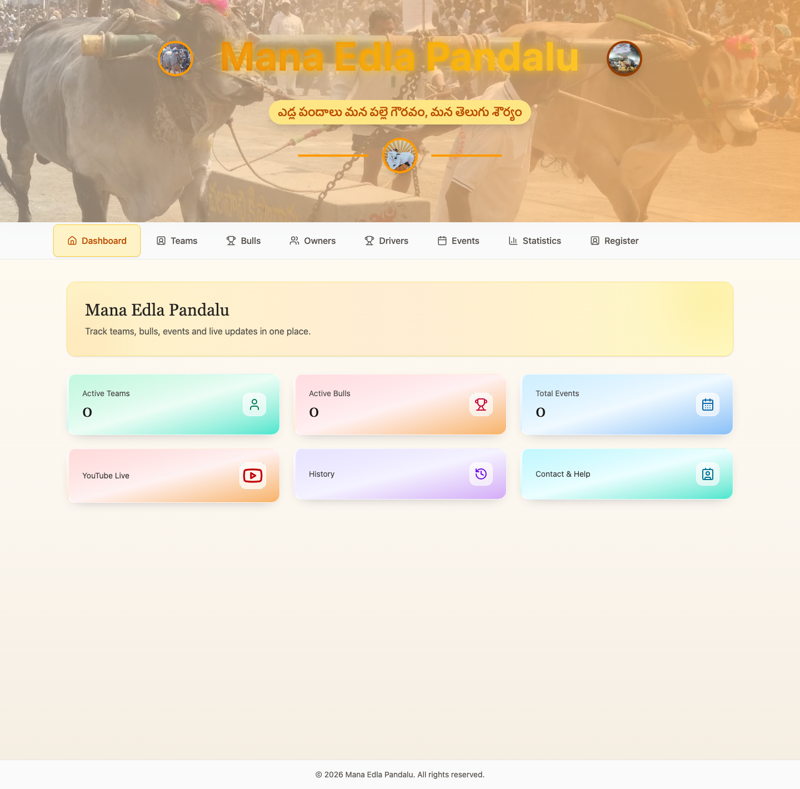
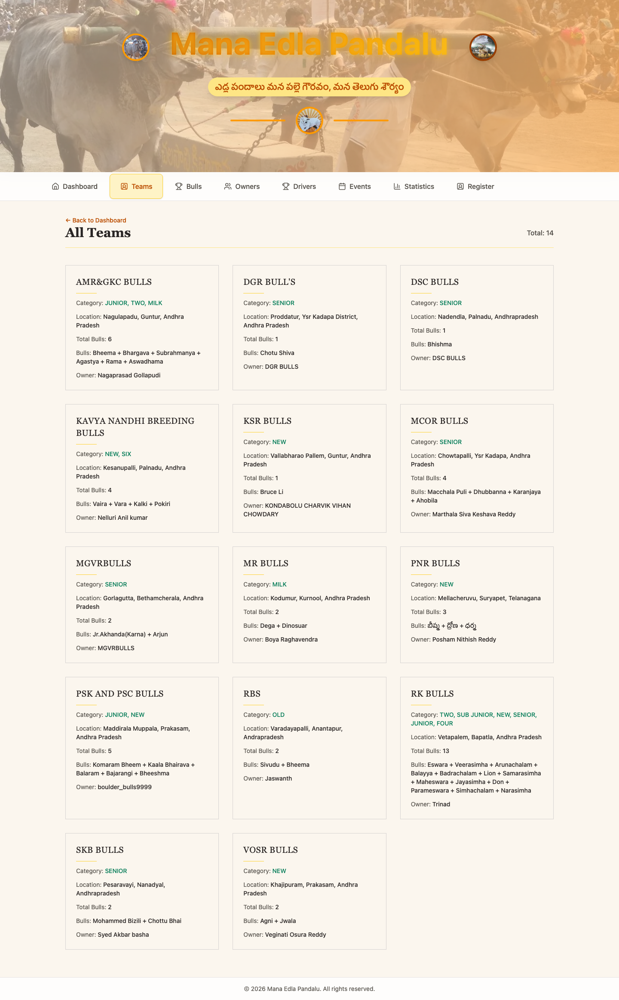
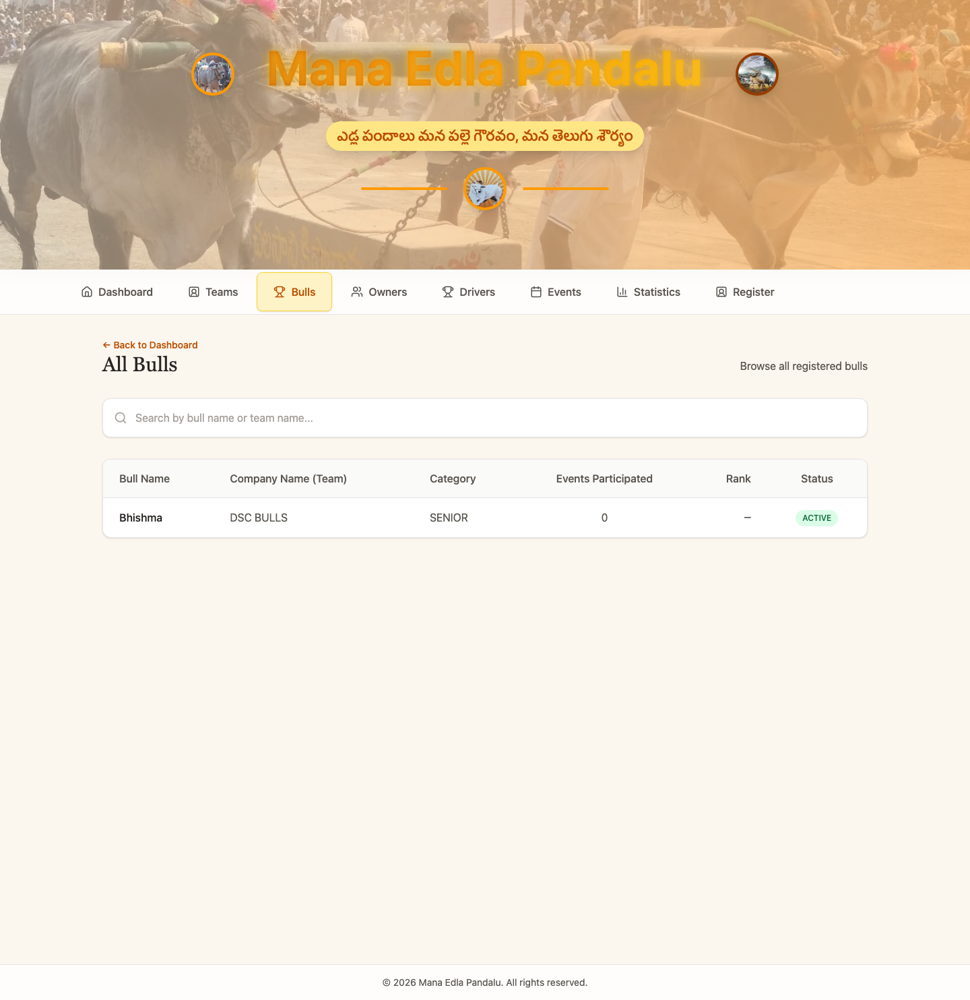
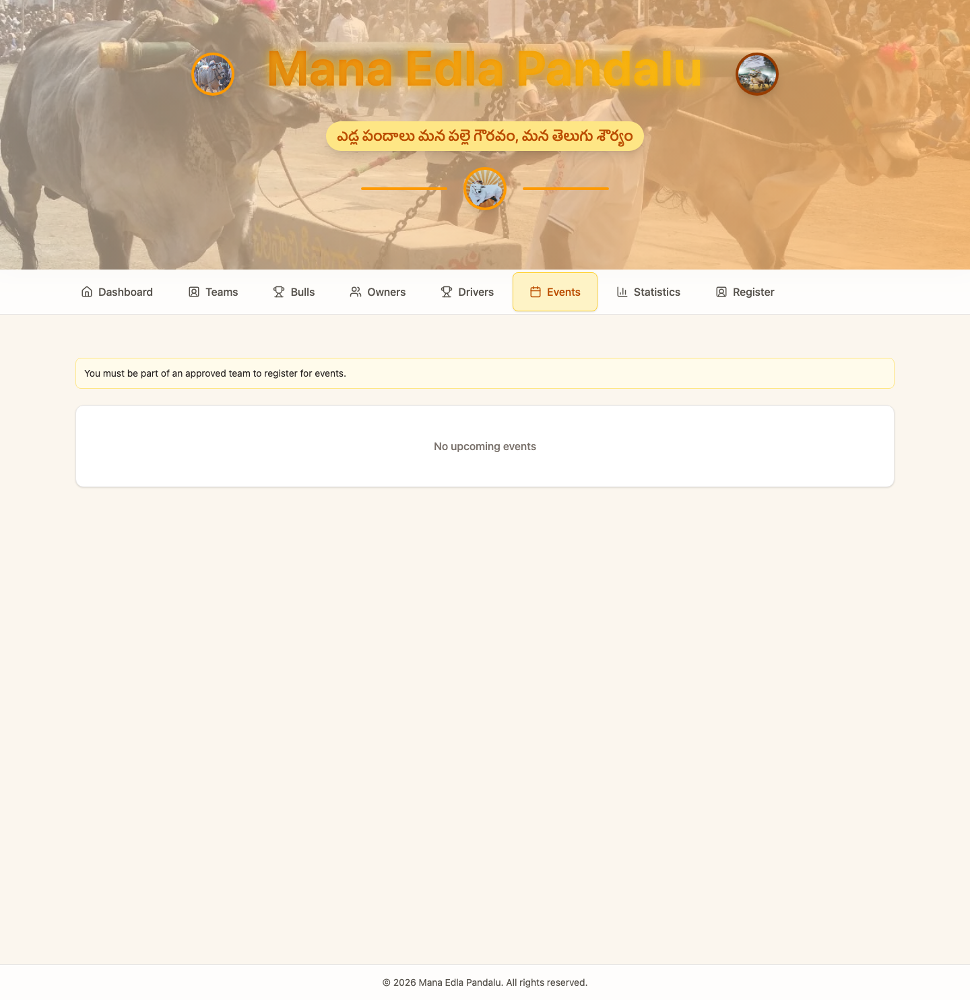
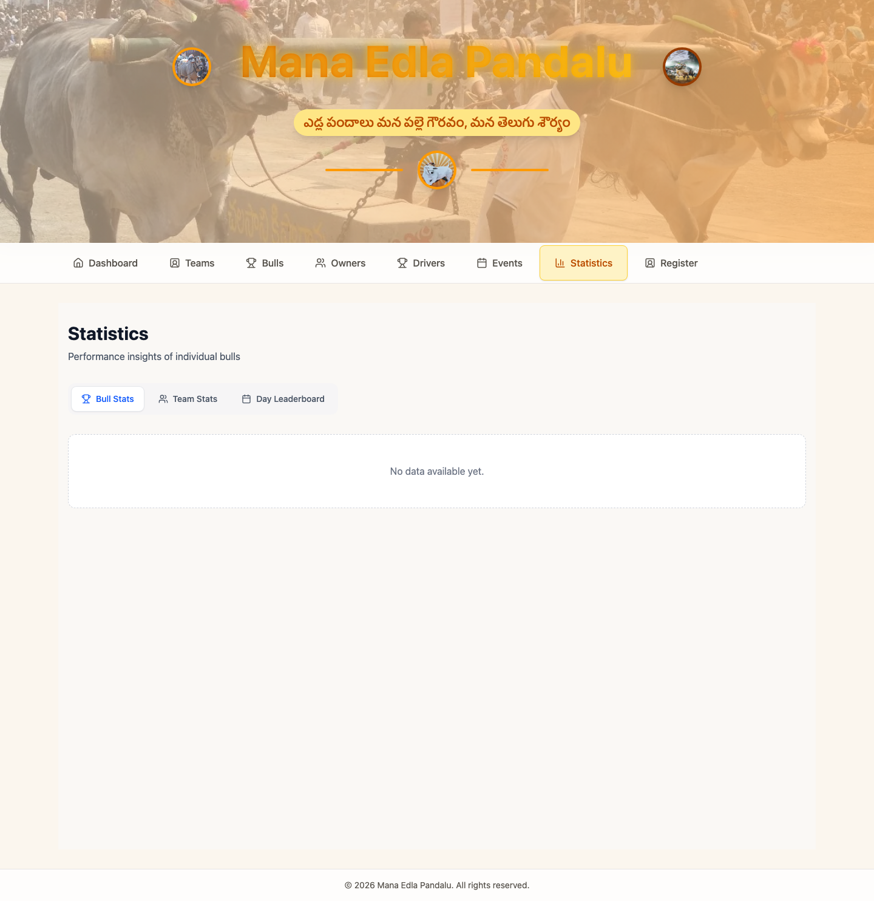
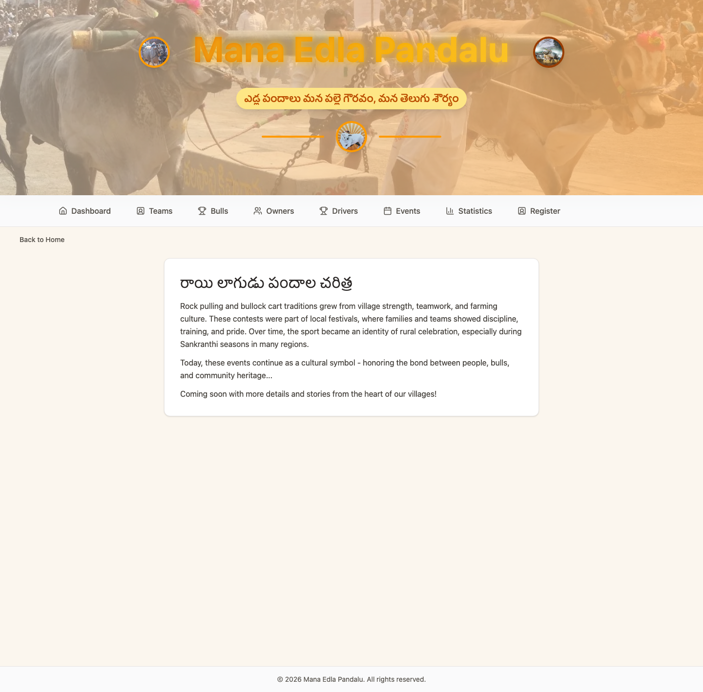

# 🐂 Mana Edla Pandalu (MEP)

### A Full-Stack Platform for Traditional Telugu Bull Racing

**Mana Edla Pandalu** is a web application designed to bring information about traditional bull racing (Edla Pandalu) in Andhra Pradesh and Telangana into one centralized platform.

> Track teams, bulls, events and live updates in one place.

🌐 **Live Website:** https://manaedlapandalu.com

## 🎯 Problem Statement

Information about traditional bull races is scattered across YouTube, social media, WhatsApp groups, and local communities.

Mana Edla Pandalu aims to bring racing teams, bulls, owners, drivers, events, and performance records together in one accessible platform.

## ✨ Features

- 🐂 Racing team management and profiles
- 🐃 Bull profiles and information
- 👨‍🌾 Owner and driver information
- 🏆 Racing events and registrations
- 📊 Statistics, rankings, and performance dashboards
- 🔐 User authentication and profile management
- 🛡️ Administrative dashboard and team approvals
- 📜 Traditional bull-racing history

## 🛠️ Technology Stack

| Layer | Technologies |
|---|---|
| Frontend | React 19, JavaScript, Vite |
| Styling | Tailwind CSS 4 |
| Routing | React Router |
| API Communication | Axios |
| Visualization | Recharts |
| Backend | Node.js, Express 5 |
| Database | MongoDB, Mongoose |
| Authentication | JWT, bcryptjs |
| Integrations | AWS S3 SDK, Twilio |

## 🏗️ Architecture

```text
             Users
               |
               v
        React Frontend
               |
               v
          REST API
               |
               v
       Node.js + Express
               |
          +----+----+
          |         |
          v         v
       MongoDB   Services
                 AWS S3
                 Twilio
```

## 📸 Application Screenshots

### 🏠 Homepage


### 🐂 Teams


### 🐃 Bulls


### 🏆 Events


### 📊 Statistics


### 📜 History


## 📂 Repositories

- **Frontend:** https://github.com/vayusudhag/mep-frontend
- **Backend:** https://github.com/vayusudhag/mep-backend

## 🚀 Local Development

### Prerequisites

- Node.js
- npm
- Compatible backend API

### Installation

```bash
git clone https://github.com/vayusudhag/mep-frontend.git
cd mep-frontend
npm install
```

Create a `.env` file:

```env
VITE_API_BASE_URL=http://localhost:5000
```

Start the frontend:

```bash
npm run dev
```

## 🎯 Project Vision

Mana Edla Pandalu aims to preserve and modernize access to traditional Telugu bull-racing information by providing a dedicated platform for participants, organizers, and enthusiasts.

---

**Connecting Traditional Sports with Modern Technology.**
